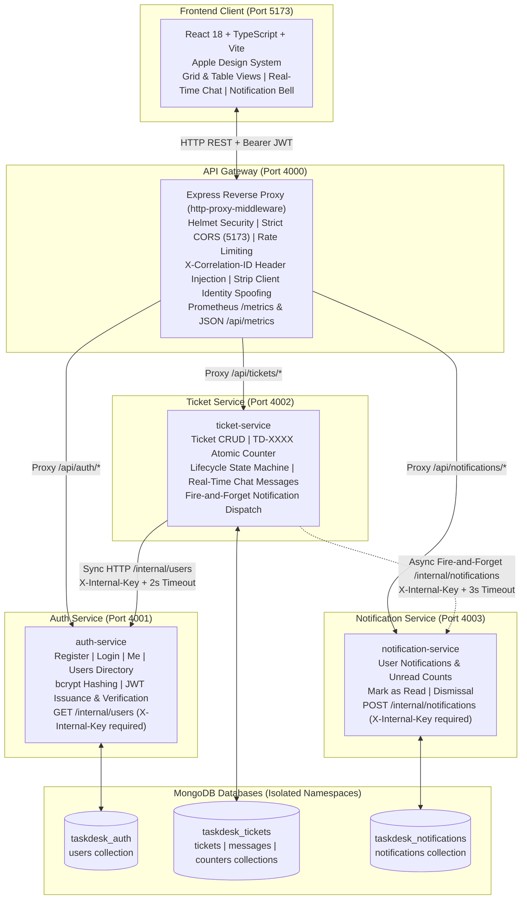
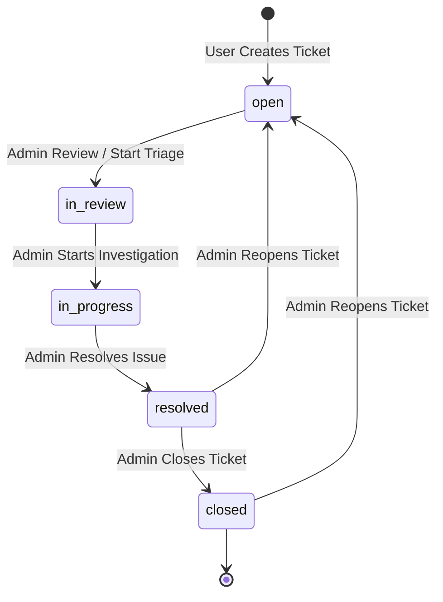

# TaskDesk – Microservice Support Ticket Tracker

> A production-grade, distributed Support Ticket Management System built with **React 18 (Vite + TypeScript)**, an **API Gateway (Port 4000)**, and three discrete **Microservices (Ports 4001, 4002, 4003)** backed by isolated **MongoDB databases**. Engineered with strict Role-Based Access Control (RBAC), inter-service REST communication, resilient fire-and-forget notifications, defense-in-depth JWT verification, request correlation tracing, structured JSON logging, and Zod runtime validation.

---

## 1. System & Microservice Architecture

The application is decomposed into independently running Node.js services communicating via HTTP/REST behind a unified API Gateway.

```
React UI (Port 5173)
     │
     ▼  [HTTP / REST + Bearer JWT]
API Gateway (Port 4000)   ─── Edge Security, Tracing, CORS, Rate Limiting, Proxying, /metrics
     │              │                     │
     ▼              ▼                     ▼
Auth Service   Ticket Service        Notification Service
 (Port 4001)     (Port 4002)             (Port 4003)
     │              │                     │
     ▼              ▼                     ▼
Database:       Database:             Database:
taskdesk_auth  taskdesk_tickets     taskdesk_notifications
```



### Microservice Directory & Responsibility Matrix

| Service | Port | Database (`dbName`) | Core Responsibility |
|---|:---:|---|---|
| **api-gateway** | `4000` | *None* | Central ingress, Helmet, CORS (`http://localhost:5173`), rate limiting, request correlation tracing, client identity header sanitization, reverse proxying, `/health`, `/metrics`. |
| **auth-service** | `4001` | `taskdesk_auth` | User registration, authentication, bcrypt (10 rounds), JWT token issuance & claims verification, `/internal/users` directory lookup. |
| **ticket-service** | `4002` | `taskdesk_tickets` | Support ticket CRUD, custom `TD-XXXX` atomic sequence generator, lifecycle state transitions, threaded support chat, internal user name resolution. |
| **notification-service** | `4003` | `taskdesk_notifications` | In-app notifications, dynamic badge counts, mark-all-as-read, `/internal/notifications` event receiver. |

---

## 2. Service-to-Service Communication (HTTP REST)

TaskDesk enforces a robust microservice communication model designed for resilience and zero coupling:

### 1. Gateway Routing & Header Sanitization
* The Gateway intercepts client requests and **strips any spoofed identity headers** (`X-User-Id`, `X-User-Role`, `X-User-Name`, `X-User-Email`).
* If a valid JWT is present, the Gateway verifies the token with the shared `JWT_SECRET` and attaches trusted identity headers before proxying.
* The Gateway forwards `Authorization: Bearer <token>` and `X-Correlation-ID` to downstream services.

### 2. Defense in Depth
* Services **do not blindly trust incoming HTTP headers**. Each service independently verifies the JWT signature using the shared `JWT_SECRET` before granting access to protected routes.
* Directly calling a service (e.g. `POST http://localhost:4002/api/tickets`) without a valid Bearer token returns `401 Unauthorized`.

### 3. Internal Service Endpoints (`X-Internal-Key`)
* Private inter-service endpoints (`GET /internal/users`, `POST /internal/notifications`) are shielded with an internal key check:
  * Callers must provide an `X-Internal-Key` header matching `INTERNAL_SERVICE_KEY`.
  * External callers or requests lacking the valid key are rejected with `401 Unauthorized` / `403 Forbidden`.

### 4. Ticket Service to Auth Service (User Identity Resolution)
* When rendering tickets for administrative oversight, `ticket-service` resolves creator names via:
  ```http
  GET http://localhost:4001/internal/users?ids=6afe...,6aff...
  Headers: X-Internal-Key: <key>, X-Correlation-ID: <id>
  ```
* **Timeout & Fallback:** Configured with a strict **2000ms timeout**. If `auth-service` is unreachable or times out, `ticket-service` falls back to the `createdByName` cached on the ticket document at creation time, preventing cascading failures.

### 5. Ticket Service to Notification Service (Fire-and-Forget Events)
* On ticket mutations (creation, status transition, review, chat message), `ticket-service` emits an event to `notification-service`:
  ```http
  POST http://localhost:4003/internal/notifications
  Headers: X-Internal-Key: <key>, X-Correlation-ID: <id>
  ```
* **Resilience:** This HTTP call is **fire-and-forget** with a **3000ms timeout**. If `notification-service` is temporarily degraded or offline, `ticket-service` logs a warning and still completes the user's ticket request successfully.

### 6. Gateway Error Handling
* If any downstream service is unreachable (e.g. `ECONNREFUSED` or crashed), the Gateway returns `503 Service Unavailable` with standard JSON:
  ```json
  {
    "error": {
      "code": "SERVICE_UNAVAILABLE",
      "message": "Downstream service is currently unreachable"
    },
    "correlationId": "481a5c6e-8e45-42b7-a021-f09bcefa904a"
  }
  ```

---

## 3. Project Structure

```text
TaskDesk/
├── .env                              # Root environment configuration (git-ignored)
├── .env.example                      # Environment template with sanitized placeholders
├── .gitignore                        # Git ignore rules (.env, node_modules, dist)
├── package.json                      # Root workspace scripts (dev, build, seed, test)
├── README.md                         # Comprehensive documentation
│
├── gateway/                          # API Gateway (Port 4000)
│   ├── package.json
│   ├── tsconfig.json
│   └── src/
│       ├── app.ts                    # Reverse proxy middleware & route dispatch
│       ├── server.ts                 # Gateway listener (Port 4000)
│       └── middleware/
│           ├── observability.middleware.ts # Tracing & metrics (/metrics, /api/metrics)
│           └── rateLimiter.middleware.ts   # Edge rate limiting
│
├── services/
│   ├── auth-service/                 # Auth Service (Port 4001)
│   │   ├── package.json
│   │   ├── tsconfig.json
│   │   └── src/
│   │       ├── app.ts
│   │       ├── server.ts
│   │       ├── config/db.ts          # Connects to dbName: "taskdesk_auth"
│   │       ├── controllers/          # auth.controller.ts (login, register, users)
│   │       ├── models/               # user.model.ts
│   │       ├── routes/               # auth.routes.ts (/api/auth & /internal/users)
│   │       └── middleware/           # auth, internalAuth, validate, observability
│   │
│   ├── ticket-service/               # Ticket Service (Port 4002)
│   │   ├── package.json
│   │   ├── tsconfig.json
│   │   └── src/
│   │       ├── app.ts
│   │       ├── server.ts
│   │       ├── config/db.ts          # Connects to dbName: "taskdesk_tickets"
│   │       ├── controllers/          # ticket.controller.ts (CRUD, chat, state machine)
│   │       ├── models/               # ticket.model.ts, message.model.ts, counter.model.ts
│   │       ├── routes/               # ticket.routes.ts
│   │       └── middleware/           # auth, validate, observability
│   │
│   └── notification-service/         # Notification Service (Port 4003)
│       ├── package.json
│       ├── tsconfig.json
│       └── src/
│           ├── app.ts
│           ├── server.ts
│           ├── config/db.ts          # Connects to dbName: "taskdesk_notifications"
│           ├── controllers/          # notification.controller.ts
│           ├── models/               # notification.model.ts
│           ├── routes/               # notification.routes.ts (/api/notifs & /internal/notifs)
│           └── middleware/           # auth, internalAuth, observability
│
├── frontend/                         # React 18 + TypeScript + Vite SPA (Port 5173)
│   ├── package.json
│   ├── vite.config.ts
│   └── src/                          # Components, context, pages, styles, types
│
├── scripts/
│   └── seed.ts                       # Database seeder across taskdesk_auth & taskdesk_tickets
│
└── tests/
    └── microservices.test.ts         # 25-test automated verification suite
```

---

## 4. Database Design & Isolation Rationale

TaskDesk uses three distinct MongoDB databases to ensure absolute service decoupling:

### 1. `taskdesk_auth` (Auth Service)
* **`users` Collection**:
  * Fields: `name` (String), `email` (String, Unique Index), `passwordHash` (String, `select: false`), `role` (`'user' | 'admin'`), timestamps.
  * **Zero Cross-Service Joins:** Other services reference users strictly by their string ID (`createdBy: String`). User records are never joined across services; name and email resolution occurs over internal HTTP REST endpoints.

### 2. `taskdesk_tickets` (Ticket Service)
* **`tickets` Collection**:
  * Fields: `customId` (String, Unique Sparse Index), `title` (String), `description` (String), `status` (Enum Index), `priority` (Enum Index), `createdBy` (String Index), `createdByName` (String, cached), `createdByEmail` (String, cached), `reviewedBy` (String), `statusHistory` (Array of audit items), timestamps.
* **`messages` Collection**:
  * Fields: `ticketId` (ObjectId Index), `senderId` (String), `senderRole` (`'user' | 'admin'`), `body` (String), timestamps.
  * Compound Index: `{ ticketId: 1, createdAt: 1 }` for instant chronological chat rendering.
* **`counters` Collection**:
  * Fields: `_id: 'ticketId'`, `seq: Number`.
  * Atomic `$inc` counter guarantees non-colliding, human-readable IDs (`TD-1001`, `TD-1002`) under high concurrent load.

### 3. `taskdesk_notifications` (Notification Service)
* **`notifications` Collection**:
  * Fields: `recipientId` (String Index), `recipientRole` (`'user' | 'admin'` Index), `ticketId` (ObjectId), `customId` (String), `type` (Enum), `title` (String), `message` (String), `read` (Boolean Index), timestamps.
  * Indexed on `{ recipientId: 1, read: 1 }` and `{ recipientRole: 1, read: 1 }` for $O(1)$ unread badge counter queries.

> **MongoDB Note for Reviewers:**
> You can connect to MongoDB Atlas or any local MongoDB instance (`mongodb://localhost:27017`). The services will automatically create the databases (`taskdesk_auth`, `taskdesk_tickets`, `taskdesk_notifications`) on initial connection.

---

## 5. Role-Based Access Control (RBAC) Matrix

| Feature / Action | Standard User | System Administrator | Backend Enforcement |
|---|:---:|:---:|---|
| **Register Account** | Yes (`role: 'user'`) | Seeded Only | Registration strictly assigns `role: 'user'` |
| **Create Support Ticket** | **Yes** | **No (403 Forbidden)** | Ticket service rejects admin creation attempts |
| **View Ticket List** | Own tickets only | All global tickets | Query filtered: `{ createdBy: user.id }` for users |
| **View Ticket Details** | Own tickets only | Any ticket | Returns `404 Not Found` for unauthorized access |
| **Edit Title / Description** | Own ticket (**`open` status only**) | **No (403 Forbidden)** | Controller blocks admin edits & closed ticket edits |
| **Review Ticket** | No (403 Forbidden) | **Yes** | `requireRole('admin')` middleware |
| **Transition Status** | No (403 Forbidden) | **Yes** | `requireRole('admin')` + lifecycle state machine |
| **Chat in Ticket Thread** | Own tickets (if not closed) | Any ticket | Users restricted to own tickets; blocked if closed |
| **Delete Ticket** | No (403 Forbidden) | **Yes** | `requireRole('admin')` middleware |
| **Admin Analytics / Stats** | No (403 Forbidden) | **Yes** | `requireRole('admin')` middleware |

---

## 6. Ticket Status Lifecycle State Machine

Ticket transitions follow a state machine enforced on `PATCH /api/tickets/:id/status`. Invalid transitions return `400 Bad Request`.



### Transition Rules
1. `open` ➔ `in_review`
2. `in_review` ➔ `in_progress` (or back to `open`)
3. `in_progress` ➔ `resolved` (or back to `in_review`)
4. `resolved` ➔ `closed` (or `open` to reopen)
5. `closed` ➔ `open` (reopens ticket)
6. Reviewing an `open` ticket (`PATCH /api/tickets/:id/review`) automatically transitions it to `in_review`.

---

## 7. Request Tracing Across Services (Correlation ID) & Observability

### 1. Correlation Tracing (`X-Correlation-ID`)
* Every incoming request receives an `X-Correlation-ID` at the Gateway.
* The Gateway forwards this header across all reverse-proxy requests.
* Inter-service calls (`ticket-service` ➔ `auth-service`, `ticket-service` ➔ `notification-service`) propagate the same `X-Correlation-ID`.
* The ID is returned in every HTTP response and included in error payloads.

### 2. Structured JSON Logging
Every service emits single-line JSON access logs on response completion:
```json
{
  "timestamp": "2026-11-19T02:08:59.318Z",
  "level": "info",
  "service": "auth-service",
  "correlationId": "71821855-af81-4d52-9714-452f826aa2c6",
  "method": "POST",
  "path": "/login",
  "statusCode": 200,
  "durationMs": 14
}
```

### 3. Prometheus Metrics & JSON Telemetry
* Every service exposes `GET /metrics` in standard Prometheus scrape format (e.g. `gateway_http_requests_total`, `auth_http_requests_total`, `ticket_http_requests_total`, `notification_http_requests_total`).
* The Gateway exposes real-time application health at `GET /api/metrics`.

---

## 8. Automated Testing Suite (25/25 Tests Passing)

TaskDesk includes a comprehensive end-to-end integration test suite verifying authentication, ticket creation, RBAC rules, request tracing, microservice isolation, and resilience.

### Running the Test Suite
```bash
npm test
```

### Test Suite Output Summary

```text
======================================================
🧪 TaskDesk Microservices Architecture Test Suite
======================================================

▶ [Phase 1/5] Authentication & Identity Management...
  ✔ [01] Admin login returns 200, JWT token and admin role
  ✔ [02] User login returns 200, JWT token and user role
  ✔ [03] Invalid password rejected with 401 Unauthorized
  ✔ [04] Zod Schema validation rejects missing email with 400 Bad Request

▶ [Phase 2/5] Ticket Creation & Atomic Counter...
  ✔ [05] Standard user creates support ticket with TD-XXXX sequential ID
  ✔ [06] RBAC Rule: Admin ticket creation blocked with 403 Forbidden
  ✔ [07] Zod Schema validation: Ticket title < 3 chars rejected with 400

▶ [Phase 3/5] RBAC Security & Ticket Lifecycle...
  ✔ [08] RBAC Rule: Admin prevented from editing ticket title/description (403)
  ✔ [09] RBAC Rule: Standard user cannot update ticket status directly (403)
  ✔ [10] Admin review transitions ticket status from open to in_review (200)
  ✔ [11] Admin transitions ticket status: in_review ➔ in_progress (200)
  ✔ [12] RBAC Rule: Non-admin accessing stats endpoint blocked with 403
  ✔ [13] Admin accesses analytics stats breakdown successfully (200)
  ✔ [14] Chat thread: User sends message on active ticket (201)
  ✔ [15] Lifecycle close: Admin transitions in_progress ➔ resolved ➔ closed
  ✔ [16] Security Rule: User messaging on closed ticket blocked with 403
  ✔ [17] Clean-up: Admin deletes test ticket (200)

▶ [Phase 4/5] Distributed Tracing & Telemetry...
  ✔ [18] Gateway returns the exact same X-Correlation-ID header supplied by caller
  ✔ [19] Prometheus /metrics endpoint exposes scrape metrics on Gateway
  ✔ [20] JSON /api/metrics endpoint returns structured telemetry on Gateway

▶ [Phase 5/5] Microservice Isolation & Defense in Depth...
  ✔ [21] Defense in Depth: Direct call to ticket-service (4002) without JWT returns 401
  ✔ [22] Internal Auth: Call to /internal/users on auth-service without internal key returns 401/403
  ✔ [23] Internal Auth: Call to /internal/notifications on notification-service without key returns 401/403
  ✔ [24] Spoofing Protection: Client-supplied X-User-Role: admin header is stripped and does not grant admin access
  ✔ [25] Gateway Resilience: When a downstream service is unreachable, returns 503 with correlationId

======================================================
✅ ALL TEST SUITES PASSED SUCCESSFULLY (25/25)
======================================================
```

---

## 9. Installation & Quick Start

### Prerequisites
* **Node.js** >= 18.x
* **npm** >= 9.x
* MongoDB connection (MongoDB Atlas cluster or local MongoDB instance)

### 1. Clone the Repository
```bash
git clone https://github.com/Shyam-creater/TaskDesk-Microservice-Ticket-Tracker.git
cd TaskDesk-Microservice-Ticket-Tracker
```

### 2. Install All Dependencies
Installs dependencies across the root, gateway, three microservices, and the frontend with one command:
```bash
npm run install:all
```

### 3. Configure Environment Variables
Copy the template to create your `.env` file:
```bash
cp .env.example .env
```
Ensure your `.env` contains valid values for:
* `MONGODB_URI`: Your MongoDB Atlas URI or `mongodb://localhost:27017`
* `JWT_SECRET`: A secure string at least 32 characters long
* `INTERNAL_SERVICE_KEY`: A shared internal secret for inter-service communication

### 4. Seed the Databases
Initializes administrative accounts, demo users, and sample tickets across `taskdesk_auth` and `taskdesk_tickets`:
```bash
npm run seed
```

### 5. Start All Services & Frontend
Launches the API Gateway (4000), Auth Service (4001), Ticket Service (4002), Notification Service (4003), and Frontend (5173) concurrently:
```bash
npm run dev
```

### 6. Access the Application
Open your browser at **`http://localhost:5173`**.

---

## 10. Demo Credentials

Quick-fill demo buttons are provided directly on the login page:

| Role | Email | Password | Display Name | Permissions |
|---|---|---|---|---|
| **Demo User** | `user@taskdesk.com` | `User1234!` | Shyam | Create tickets, view/edit own open tickets, live chat support, notification bell |
| **Demo Admin** | `admin@taskdesk.com` | `Admin1234!` | System Administrator | Global ticket table & grid, analytics stats, triage reviews, status transitions, delete |

---

## 11. AI Tools Used

The following AI tools and foundational models were used in the engineering and architectural execution of TaskDesk:

* **Google Antigravity**:
  * Agentic execution platform used for microservice directory restructuring, multi-process orchestration, background daemon management, terminal sandboxing, and automated test execution.
* **Gemini 2.5 Pro / Flash**:
  * Primary foundational models powering Antigravity. Used for TypeScript strict-mode typing, reverse-proxy routing logic, defense-in-depth security verification, and test suite generation.
* **Claude (Anthropic)**:
  * Consulted during planning and documentation for architectural review of the microservices topology, request correlation tracing, and Apple Human Interface Design principles.

---

## 12. Trade-offs & Future Improvements

1. **Shared Database Cluster vs Physical Database Isolation**:
   * *Current:* Services connect to distinct database namespaces (`taskdesk_auth`, `taskdesk_tickets`, `taskdesk_notifications`) on the same Atlas cluster.
   * *Future:* In large enterprise scale, each service would point to physically independent database clusters for complete fault isolation.
2. **Synchronous HTTP vs Distributed Message Broker**:
   * *Current:* Notifications use fire-and-forget HTTP calls with a 3-second timeout.
   * *Future:* Adopting a message broker (RabbitMQ, Kafka, or Redis Pub/Sub) would guarantee at-least-once delivery and offload event processing under extreme spikes.
3. **Chat Polling vs WebSockets / SSE**:
   * *Current:* Frontend polls ticket chat messages every 5 seconds.
   * *Future:* Upgrading to Socket.io or Server-Sent Events (SSE) would provide sub-second message delivery with reduced HTTP header overhead.
4. **Correlation Tracing vs Full OpenTelemetry**:
   * *Current:* Lightweight `X-Correlation-ID` passed across all services and emitted in structured JSON logs.
   * *Future:* Exporting W3C TraceContext spans to Jaeger or Datadog APM for distributed flame graphs.
5. **Static JWT Expiration vs Refresh Token Rotation**:
   * *Current:* Standard 7-day JWT tokens for simplicity.
   * *Future:* Short-lived access tokens (15m) paired with rotating refresh tokens stored in secure `HttpOnly` cookies.

---

## 13. API Reference

All client API traffic is addressed to the API Gateway at `http://localhost:4000/api`.

### Authentication Endpoints (`/api/auth`)

| Method | Endpoint | Auth | Description |
|---|---|:---:|---|
| `POST` | `/api/auth/register` | Public (Zod) | Registers new user (`role: 'user'`), returns JWT & profile |
| `POST` | `/api/auth/login` | Public (Zod) | Authenticates user/admin, returns JWT & profile |
| `GET` | `/api/auth/me` | Bearer JWT | Returns current authenticated user profile |
| `GET` | `/api/auth/users` | Bearer JWT (Admin) | Lists registered users for name resolution |

### Ticket Endpoints (`/api/tickets`)

| Method | Endpoint | Auth | Description |
|---|---|:---:|---|
| `GET` | `/api/tickets` | Bearer JWT | Lists tickets (own tickets for users, global for admins) |
| `POST` | `/api/tickets` | Bearer JWT (User, Zod) | Creates ticket with sequential `TD-XXXX` ID |
| `GET` | `/api/tickets/stats` | Bearer JWT (Admin) | Returns status breakdown counts |
| `GET` | `/api/tickets/:id` | Bearer JWT | Gets ticket details by ObjectId or `customId` |
| `PATCH` | `/api/tickets/:id` | Bearer JWT (User, Zod) | Updates title/description (open status only) |
| `PATCH` | `/api/tickets/:id/status` | Bearer JWT (Admin, Zod) | Transitions ticket status via validated state machine |
| `PATCH` | `/api/tickets/:id/review` | Bearer JWT (Admin, Zod) | Marks ticket reviewed; sets priority; moves open ➔ in_review |
| `DELETE` | `/api/tickets/:id` | Bearer JWT (Admin) | Permanently deletes ticket and chat thread |
| `GET` | `/api/tickets/:id/messages`| Bearer JWT | Retrieves chat messages for ticket |
| `POST` | `/api/tickets/:id/messages`| Bearer JWT (Zod) | Posts message (blocked if ticket is closed) |

### Notification Endpoints (`/api/notifications`)

| Method | Endpoint | Auth | Description |
|---|---|:---:|---|
| `GET` | `/api/notifications` | Bearer JWT | Retrieves user/admin notifications & unread counts |
| `PATCH` | `/api/notifications/read-all` | Bearer JWT | Marks all notifications as read |
| `PATCH` | `/api/notifications/:id/read` | Bearer JWT | Marks single notification as read |
| `DELETE` | `/api/notifications/:id` | Bearer JWT | Deletes a notification |

### Observability Endpoints

| Method | Endpoint | Auth | Description |
|---|---|:---:|---|
| `GET` | `/health` | Public | Service health status (`{ status: "ok" }`) |
| `GET` | `/metrics` | Public | Prometheus scrape metrics (`gateway_http_requests_total`, etc.) |
| `GET` | `/api/metrics` | Public | JSON runtime telemetry (`uptimeSeconds`, request counts, memory) |
