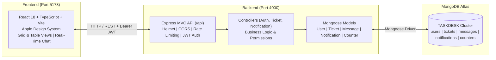
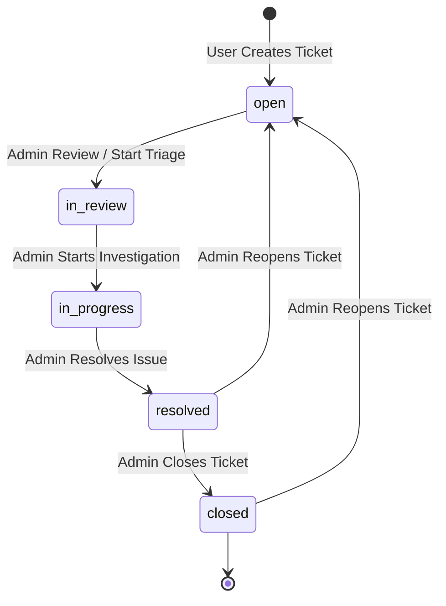

# TaskDesk – Full-Stack Support Ticket Tracker

> A modern, production-grade support ticket management platform built with **React (Vite)**, **TypeScript**, **Node.js/Express (MVC Architecture)**, and **MongoDB Atlas**. Designed with strict Role-Based Access Control (RBAC), real-time ticket messaging, Apple-inspired Human Interface UI, sequential custom ticket IDs (`TD-XXXX`), dual Table/Grid views, and smooth filter loading.

---

## 1. System Overview & User Roles

TaskDesk provides an enterprise-ready ticket tracking system featuring distinct separation of responsibilities between **Standard Users** and **Administrators**.



### Core User Roles

#### 👤 Standard User (e.g. Shyam)
- **Registration & Authentication**: Self-registers through the signup page (strictly assigned `role: 'user'`).
- **Ticket Creation**: Creates support tickets with Title, Description, and Priority (`low`, `medium`, `high`).
- **Sequential Ticket IDs**: Tickets automatically receive clean, formatted IDs (`TD-1001`, `TD-1002`, etc.).
- **Scoped Visibility**: Users can view and search **only their own tickets**.
- **Content Editing**: Can edit Title and Description **only while the ticket is `open`**.
- **Real-Time Support Chat**: Engages in two-way support chat with administrators on open/in-progress tickets (blocked once closed).

#### 🛡️ System Administrator
- **Admin Dashboard**: Views analytics summary cards showing counts for `Total`, `Open`, `In Review`, `In Progress`, `Resolved`, and `Closed` tickets.
- **Global Ticket Oversight**: Views, filters, and searches all tickets across all users in either **Grid** or **Table** view.
- **Creator Visibility**: Automatically views creator identity (e.g., `Shyam`) and email for every ticket.
- **Strict Content Protection**: **Administrators CANNOT edit ticket title or description** (user content is strictly read-only for admins).
- **Ticket Creation Restriction**: Admins manage tickets but **cannot create tickets** (`403 Forbidden`).
- **Status Lifecycle Control**: Transitions tickets through strict server-validated states.
- **Triage & Review**: Reviews tickets and adjusts priority as needed.
- **Ticket Deletion**: Permanently deletes tickets and associated chat threads.

---

## 2. Role-Based Access Control (RBAC) Matrix

| Feature / Action | Standard User | System Administrator | Backend Enforcement |
|---|:---:|:---:|---|
| **Register Account** | Yes (`role: 'user'`) | Seeded Only | Registration strictly assigns `role: 'user'` |
| **Create Support Ticket** | **Yes** | **No (403 Forbidden)** | Controller rejects admin creation attempts |
| **View Ticket List** | Own tickets only | All global tickets | Query filtered: `{ createdBy: user.id }` for users |
| **View Ticket Details** | Own tickets only | Any ticket | Returns `404 Not Found` for unauthorized access |
| **Edit Title / Description** | Own ticket (**`open` status only**) | **No (403 Forbidden)** | Controller blocks admin edits & closed ticket edits |
| **Review Ticket** | No (403 Forbidden) | **Yes** | `requireRole('admin')` middleware |
| **Transition Status** | No (403 Forbidden) | **Yes** | `requireRole('admin')` + lifecycle state machine |
| **Chat in Ticket Thread** | Own tickets (if not closed) | Any ticket | Users restricted to own tickets; blocked if closed |
| **Delete Ticket** | No (403 Forbidden) | **Yes** | `requireRole('admin')` middleware |
| **Admin Analytics / Stats** | No (403 Forbidden) | **Yes** | `requireRole('admin')` middleware |

---

## 3. Ticket Status Lifecycle

Ticket transitions follow a state machine enforced on `PATCH /api/tickets/:id/status`. Invalid transitions return `400 Bad Request`.



### Transition Rules
1. `open` ➔ `in_review`
2. `in_review` ➔ `in_progress` (or back to `open`)
3. `in_progress` ➔ `resolved` (or back to `in_review`)
4. `resolved` ➔ `closed` (or `open` to reopen)
5. `closed` ➔ `open` (reopens ticket)
6. Reviewing an `open` ticket (`PATCH /api/tickets/:id/review`) automatically transitions it to `in_review`.

---

## 4. Full-Stack MVC Architecture & Folder Structure

The project is structured into standard Full-Stack `frontend/` and `backend/` layers with a clean **MVC (Model-View-Controller)** pattern:

```text
TaskDesk/
├── .env                              # Single project environment configuration
├── .env.example                      # Template environment variables
├── package.json                      # Root workspace scripts
├── README.md                         # Project documentation
│
├── backend/                          # Express + TypeScript MVC Backend
│   ├── src/
│   │   ├── config/
│   │   │   └── db.ts                 # MongoDB Atlas connection (process.env.MONGODB_URI)
│   │   ├── controllers/
│   │   │   ├── auth.controller.ts    # Authentication & User management logic
│   │   │   ├── notification.controller.ts # Notification fetch, read, & broadcast logic
│   │   │   └── ticket.controller.ts  # Ticket CRUD, status, review, and chat logic
│   │   ├── middleware/
│   │   │   ├── auth.middleware.ts    # JWT verification & requireRole('admin')
│   │   │   ├── error.middleware.ts   # Global error handling & custom AppErrors
│   │   │   └── rateLimiter.middleware.ts # Security rate limiters (auth & global)
│   │   ├── models/
│   │   │   ├── counter.model.ts      # Atomic sequence counter for TD-XXXX
│   │   │   ├── message.model.ts      # Real-time ticket chat messages
│   │   │   ├── notification.model.ts # Role-based & user notifications schema
│   │   │   ├── ticket.model.ts       # Support ticket model & status history
│   │   │   └── user.model.ts         # User model with passwordHash & role
│   │   ├── routes/
│   │   │   ├── auth.routes.ts        # /api/auth route mappings
│   │   │   ├── notification.routes.ts # /api/notifications route mappings
│   │   │   ├── ticket.routes.ts      # /api/tickets route mappings
│   │   │   └── index.ts              # Combined /api router
│   │   ├── app.ts                    # Express app configuration & middleware
│   │   ├── seed.ts                   # Initial database seeds (Admin, User, Tickets)
│   │   └── server.ts                 # Server entry point (starts server on Port 4000)
│   ├── package.json
│   └── tsconfig.json
│
└── frontend/                         # React 18 + TypeScript + Vite SPA
    ├── src/
    │   ├── api/
    │   │   └── client.ts             # Axios client with JWT interceptor & baseURL
    │   ├── components/
    │   │   ├── Badge.tsx             # StatusBadge & PriorityBadge components
    │   │   ├── ChatThread.tsx        # Real-time support chat thread with 5s polling
    │   │   ├── CreateTicketModal.tsx # New ticket submission modal (User only)
    │   │   ├── DeleteConfirmModal.tsx# Ticket deletion confirmation modal (Admin only)
    │   │   ├── Navbar.tsx            # Navigation bar with role badge & logout
    │   │   ├── NotificationBell.tsx  # Apple-style notification bell with live popover
    │   │   ├── ProtectedRoute.tsx    # Route guard with authentication & role checks
    │   │   ├── SegmentedControl.tsx  # Apple-style segmented filter tabs
    │   │   ├── Skeleton.tsx          # Pulse placeholder skeletons for initial load
    │   │   ├── TicketDetailModal.tsx # Full ticket view, metadata, chat, & admin actions
    │   │   └── ViewToggle.tsx        # Grid vs Table view format switcher
    │   ├── context/
    │   │   ├── AuthContext.tsx       # Auth state, user session, login, and logout
    │   │   └── ToastContext.tsx      # System notification toast provider
    │   ├── pages/
    │   │   ├── AdminPage.tsx         # Admin dashboard, stats, filters, grid/table
    │   │   ├── LoginPage.tsx         # Login page with Demo User & Demo Admin quick-fill
    │   │   ├── NotFoundPage.tsx      # 404 page
    │   │   ├── RegisterPage.tsx      # User registration page
    │   │   └── TicketsPage.tsx       # User dashboard, filters, grid/table
    │   ├── styles/
    │   │   └── index.css             # Apple design tokens, animations, progress bar
    │   ├── types/
    │   │   └── index.ts              # Shared TypeScript interfaces & formatTicketId helper
    │   ├── App.tsx                   # React Router route configuration
    │   └── main.tsx                  # Application entry point
    ├── index.html
    ├── package.json
    ├── tsconfig.json
    └── vite.config.ts                # Vite dev server with proxy to port 4000
```

---

## 5. UI/UX Highlights

- **Apple Human Interface Design**: Soft background `#F5F5F7`, clean typography stack (`-apple-system, SF Pro`), rounded corners, and crisp elevation shadows.
- **Dual View Modes (Grid & Table)**:
  - **Grid Format**: High-contrast cards featuring a 4px colored priority accent border (🔴 High: `#FF3B30`, 🟠 Medium: `#FF9500`, 🔵 Low: `#0071E3`), formatted title, 2-line clamped description, creator initial avatar, and quick action buttons.
  - **Table Format**: Strict `tableLayout: 'fixed'` with optimized Details width, preventing horizontal bottom scrollbars across all desktop viewports.
- **Smooth Filter Transitions (Zero Blink)**:
  - Changing status tabs, priority filters, or stat cards retains existing tickets on screen.
  - Tickets smoothly dim (`opacity: 0.55`) while an animated accent loading bar glides across the top edge with a floating `"Updating..."` pill badge.
  - Skeletons are reserved strictly for the very first page visit, completely eliminating layout flashing.
- **Real-Time Support Chat**: Integrated directly inside the ticket detail modal with 5-second polling, role-colored chat bubbles, and auto-scrolling to the latest message.
- **Apple-Inspired Notification Bell**:
  - Located in the global Navbar with dynamic unread count badge.
  - Glassmorphic dropdown popover (`backdropFilter: 'blur(25px)'`) with custom icons per event type (`ticket_created`, `status_updated`, `ticket_reviewed`, `message_received`).
  - Auto-polling every 10 seconds for real-time updates.
  - "Mark all as read" one-click action, individual notification dismissal, and unread blue indicators.
  - Deep linking: clicking any notification directly opens the associated ticket modal seamlessly.

---

## 6. Environment Variables (`.env`)

The project uses a **single root `.env` file** with no duplicate configuration files or hardcoded fallback secrets:

```env
# ==============================================================================
# TaskDesk Environment Configuration
# ==============================================================================

# Server Configuration
PORT=4000
NODE_ENV=development
CORS_ORIGIN=*

# MongoDB Atlas
MONGODB_URI=mongodb+srv://<username>:<password>@cluster0.rfz95.mongodb.net/TASKDESK?retryWrites=true&w=majority

# JWT Authentication
JWT_SECRET=your_jwt_secret_key_at_least_32_characters_long
JWT_EXPIRES_IN=7d

# Frontend Configuration
VITE_API_URL=http://localhost:4000/api
```

---

## 7. Installation & Quick Start

### Prerequisites
- **Node.js** >= 18.x
- **npm** >= 9.x
- Active Internet connection (for MongoDB Atlas cluster)

### 1. Clone & Setup
```bash
git clone https://github.com/Shyam-creater/TaskDesk-Microservice-Ticket-Tracker.git
cd TaskDesk
```

### 2. Install Dependencies
```bash
# Install backend dependencies
npm install --prefix backend

# Install frontend dependencies
npm install --prefix frontend
```

### 3. Start the Backend Server
```bash
# Builds and starts the Express backend on port 4000
npm run dev:backend
# OR from backend directory:
cd backend && npm run build && npm start
```

### 4. Start the Frontend Dev Server
```bash
# Starts Vite dev server on port 5173
npm run dev:frontend
# OR from frontend directory:
cd frontend && npm run dev
```

The frontend will be running at `http://localhost:5173` and automatically proxies `/api` requests to `http://localhost:4000`.

---

## 8. Demo Credentials

Quick-fill demo buttons are provided on the login page:

| Role | Email | Password | Display Name |
|---|---|---|---|
| **Demo User** | `user@taskdesk.com` | `User1234!` | Shyam |
| **Demo Admin** | `admin@taskdesk.com` | `Admin1234!` | System Administrator |

---

## 9. API Reference

All backend API routes are prefixed with `/api`.

### Authentication Endpoints (`/api/auth`)

| Method | Endpoint | Auth | Description |
|---|---|:---:|---|
| `POST` | `/api/auth/register` | Public | Register a new user (`name`, `email`, `password`) |
| `POST` | `/api/auth/login` | Public | Authenticate user/admin, returns JWT token & user object |
| `GET` | `/api/auth/me` | Bearer JWT | Fetch current authenticated user profile |
| `GET` | `/api/auth/users` | Bearer JWT (Admin) | Fetch list of registered users for name resolution |

### Ticket Endpoints (`/api/tickets`)

| Method | Endpoint | Auth | Description |
|---|---|:---:|---|
| `GET` | `/api/tickets` | Bearer JWT | List tickets (filtered: own tickets for users, all for admins) |
| `POST` | `/api/tickets` | Bearer JWT (User) | Create a ticket (admins blocked with `403`) |
| `GET` | `/api/tickets/stats` | Bearer JWT (Admin) | Status breakdown counts (`open`, `in_review`, etc.) |
| `GET` | `/api/tickets/:id` | Bearer JWT | Get ticket details by MongoDB `_id` or `customId` (`TD-XXXX`) |
| `PATCH` | `/api/tickets/:id` | Bearer JWT (User) | Edit Title/Description (owner only, open status only; admin blocked with `403`) |
| `PATCH` | `/api/tickets/:id/status` | Bearer JWT (Admin) | Transition status according to validated lifecycle |
| `PATCH` | `/api/tickets/:id/review` | Bearer JWT (Admin) | Mark ticket as reviewed; sets priority; moves `open` to `in_review` |
| `DELETE` | `/api/tickets/:id` | Bearer JWT (Admin) | Permanently delete ticket and associated messages |
| `GET` | `/api/tickets/:id/messages`| Bearer JWT | Fetch chat thread messages for ticket |
| `POST` | `/api/tickets/:id/messages`| Bearer JWT | Send a message in the ticket thread |

### Notification Endpoints (`/api/notifications`)

| Method | Endpoint | Auth | Description |
|---|---|:---:|---|
| `GET` | `/api/notifications` | Bearer JWT | Fetch user notifications (admin receives broadcast admin notifications) + unread count |
| `PATCH` | `/api/notifications/read-all` | Bearer JWT | Mark all notifications for the user as read |
| `PATCH` | `/api/notifications/:id/read` | Bearer JWT | Mark a specific notification as read |
| `DELETE` | `/api/notifications/:id` | Bearer JWT | Delete a specific notification |

---

## 10. Verification & Quality Assurance

- **TypeScript Strict Mode**: Zero `any` types across backend controllers, models, and frontend components.
- **Production Builds**:
  - `npm run build:backend` ➔ `tsc` outputs clean ES modules to `backend/dist/`.
  - `npm run build:frontend` ➔ `tsc && vite build` outputs optimized production bundle to `frontend/dist/`.
- **Database Resilience**: Connected directly to MongoDB Atlas cluster `TASKDESK`, with atomic counter sequences ensuring collision-free ticket IDs under concurrent requests.
