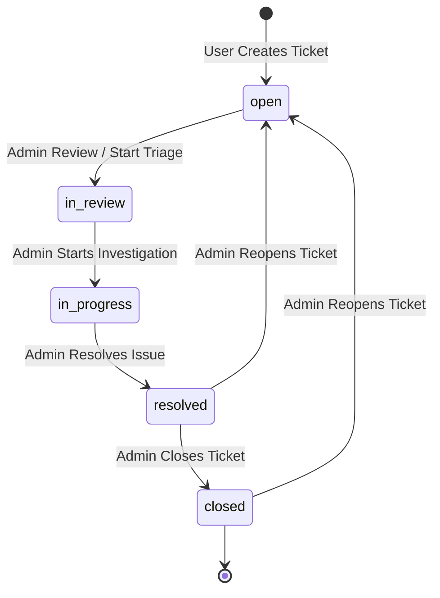
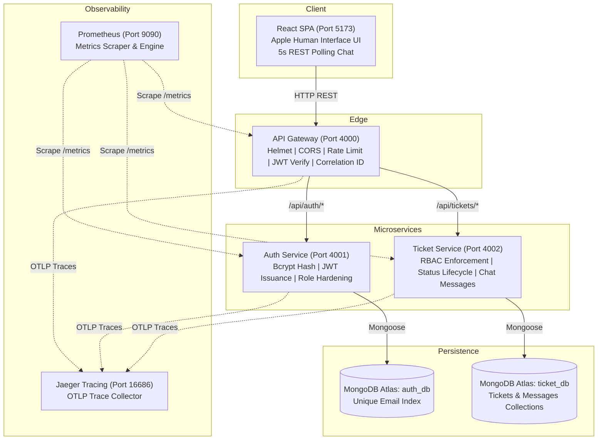

# TaskDesk – Microservice Support Ticket Tracker

> A production-grade, distributed support-ticket tracker built with **TypeScript**, **MongoDB (MongoDB Atlas)**, **Express**, and **React (Vite)** adhering to strict microservice architecture, strict Role-Based Access Control (RBAC), real-time ticket messaging, observability (OpenTelemetry, Jaeger, Prometheus, Pino), defense-in-depth security, and Apple-inspired Human Interface Design.

---

## 1. Project Overview & User Flow

**TaskDesk** demonstrates end-to-end cloud-native microservice engineering. The system provides clear separation between **Users** (who raise issues and chat with support) and **Admins** (who triage, review, chat, transition lifecycle states, and manage system tickets).

### Core Roles

#### User (Raises the issue)
- Registers and logs in (**new registrations are strictly assigned role `user`**; admin cannot self-register).
- Creates support tickets specifying title, description, and priority (`POST /api/tickets`).
- Views **only their own** tickets and sees the current status (read-only status badge; user cannot change status).
- Edits own ticket title and description **only while the ticket is `open`**.
- Opens ticket details, reads admin responses, and **chats in the ticket conversation** via live REST polling.
- Blocked from posting messages once a ticket is `closed`.

#### Admin (Handles the issue)
- Seeded system administrator account (`admin@taskdesk.com`), never self-registered.
- **Cannot create tickets** (`403 Forbidden` if attempted).
- Views **all global tickets** across all users, with status and priority filters (`GET /api/tickets`).
- Reviews tickets and marks as reviewed (`PATCH /api/tickets/:id/review`).
- Replies in the live ticket chat on **any ticket**.
- Transitions ticket status through server-validated lifecycle steps (`PATCH /api/tickets/:id/status`).
- Deletes tickets permanently (`DELETE /api/tickets/:id`).
- Accesses the Admin Analytics Dashboard with breakdown counts per status (`GET /api/tickets/stats`).

---

## 2. Role-Based Access Control (RBAC) Matrix

| Action | Standard User | Administrator | Backend Enforcement |
|---|:---:|:---:|---|
| **Register Account** | Yes (forces `role: 'user'`) | Seeded Only | Ignores/rejects `role: 'admin'` in registration payload |
| **Create Ticket** | Yes | **No (403 Forbidden)** | `requireUser` middleware & service validation |
| **View Ticket List** | Own tickets only | All global tickets | User filter: `{ createdBy: user.id }` |
| **View Ticket Details** | Own tickets only | Any ticket | Returns `404 Not Found` for unauthorized user requests |
| **Edit Title / Description** | Own ticket (**only while `open`**) | No | Rejected with `400 Bad Request` if status != `open` |
| **Review Ticket** | No (403 Forbidden) | **Yes** | `requireAdmin` middleware |
| **Change Status / Priority** | No (403 Forbidden) | **Yes** | `requireAdmin` middleware + lifecycle validation |
| **Chat in Ticket Thread** | Own tickets only | Any ticket | Returns `404` for non-owner; `400` if ticket is `closed` |
| **Delete Ticket** | No (403 Forbidden) | **Yes** | `requireAdmin` middleware |
| **Admin Dashboard / Stats** | No (403 Forbidden) | **Yes** | `requireAdmin` middleware |

---

## 3. Ticket Status Lifecycle (Server-Validated)

Ticket status progressions are strictly enforced by the backend on `PATCH /tickets/:id/status`. Invalid status transitions return `400 Bad Request`.



### Transition Rules
1. `open -> in_review`
2. `in_review -> in_progress`
3. `in_progress -> resolved`
4. `resolved -> closed` (or `open` to reopen)
5. `closed -> open` (reopen ticket)
6. Any other jump (e.g., `open -> closed` directly) is rejected by the server with `400 Bad Request`.
7. Marking a ticket as reviewed (`PATCH /tickets/:id/review`) automatically transitions an `open` ticket into `in_review`.

---

## 4. Architecture & Microservices Decomposition

TaskDesk is decomposed into three backend microservices, a frontend Single-Page Application (SPA), a MongoDB cluster, and an observability suite.



### Why This Architecture?
- **Database-Per-Service Pattern**: `auth-service` exclusively owns `auth_db` and `ticket-service` exclusively owns `ticket_db`. Neither service performs cross-database joins or queries.
- **Defense-in-Depth Authentication**: The API Gateway verifies token signatures and passes correlation IDs; downstream `ticket-service` also re-verifies tokens cryptographically and extracts `senderRole` from verified JWT claims.
- **REST Polling Chat Architecture**: Chat updates use REST polling every 5 seconds (`GET /api/tickets/:id/messages`):
  - **Simplicity & Reliability**: Operates over standard HTTP without WebSocket handshake complexities, proxy connection drops, or stateful socket timeouts.
  - **Stateless Horizontal Scalability**: Any service instance behind a load balancer can handle polling requests without sticky sessions or socket coordination brokers (e.g. Redis pub/sub).
  - **Resilience**: Client automatically recovers immediately from network interruptions without reconnection logic.
  - *Future Optimization*: WebSockets / Server-Sent Events (SSE) can be introduced if sub-second latency is required at high scale.

---

## 5. Database Schema Design (MongoDB)

### Database: `auth_db`
#### Collection: `users`
| Field | Type | Attributes | Description |
|---|---|---|---|
| `_id` | ObjectId | Primary Key | Auto-generated MongoDB ObjectId |
| `name` | String | Required, trim, min 2, max 100 | Full name of the user |
| `email` | String | Required, unique, lowercase, trim | User email address (login identifier) |
| `passwordHash` | String | Required, `select: false` | Bcrypt hash (cost 10); excluded from queries |
| `role` | String | Enum: `'user'`, `'admin'`; default `'user'` | Role for authorization checks |
| `createdAt` | Date | Timestamp | Account creation timestamp |
| `updatedAt` | Date | Timestamp | Account update timestamp |

**Indexes**:
- Unique index on `{ email: 1 }`

---

### Database: `ticket_db`
#### Collection: `tickets`
| Field | Type | Attributes | Description |
|---|---|---|---|
| `_id` | ObjectId | Primary Key | Auto-generated MongoDB ObjectId |
| `title` | String | Required, trim, min 3, max 100 | Summary of the support ticket |
| `description` | String | Trim, max 1000, default `""` | Detailed description of the problem |
| `status` | String | Enum: `'open'`, `'in_review'`, `'in_progress'`, `'resolved'`, `'closed'` | Current ticket workflow status |
| `priority` | String | Enum: `'low'`, `'medium'`, `'high'`; default `'medium'` | Severity of the issue |
| `createdBy` | String | Required, index | User ID string referencing owner in `auth-service` |
| `reviewedBy` | String | Optional, string | Administrator ID who reviewed the ticket |
| `reviewedAt` | Date | Optional, date | Timestamp when ticket was reviewed |
| `statusHistory` | Array | `[{ from, to, changedBy, changedAt }]` | Audit log of status transitions |
| `createdAt` | Date | Timestamp | Creation timestamp |
| `updatedAt` | Date | Timestamp | Last update timestamp |

**Indexes**:
- Index on `{ createdBy: 1, status: 1 }`: Optimized for user queries filtering tickets by status.
- Index on `{ status: 1, priority: 1 }`: Optimized for admin dashboard and filter queries.
- Index on `{ createdAt: -1 }`: Chronological listing and pagination.

#### Collection: `messages` (New, separate from tickets)
| Field | Type | Attributes | Description |
|---|---|---|---|
| `_id` | ObjectId | Primary Key | Auto-generated MongoDB ObjectId |
| `ticketId` | ObjectId | Required, indexed | Reference to parent ticket in `tickets` collection |
| `senderId` | String | Required | ID of the user or administrator sending the message |
| `senderRole` | String | Enum: `'user'`, `'admin'` | Role of sender derived strictly from verified JWT |
| `body` | String | Required, trim, min 1, max 1000 | Message content |
| `createdAt` | Date | Timestamp | Message post timestamp |

**Indexes**:
- Compound index on `{ ticketId: 1, createdAt: 1 }`: Fast retrieval of chronological ticket conversation threads.

---

## 6. API Reference

All requests route through the **API Gateway** (`http://localhost:4000/api`).

### Authentication (`/api/auth/*`)
| Method | Endpoint | Auth | Description | Status Codes |
|---|---|---|---|---|
| `POST` | `/api/auth/register` | None | Register new user (always role `user`) | `201`, `400`, `409` |
| `POST` | `/api/auth/login` | None | Authenticate credentials & receive JWT | `200`, `400`, `401` |
| `GET` | `/api/auth/me` | Bearer | Retrieve profile of authenticated user | `200`, `401`, `404` |

### Tickets (`/api/tickets/*`)
| Method | Endpoint | Auth | Description | Status Codes |
|---|---|---|---|---|
| `POST` | `/api/tickets` | Bearer (User) | Create new support ticket (**User only**) | `201`, `400`, `401`, `403` |
| `GET` | `/api/tickets` | Bearer | List tickets (User: own; Admin: all with status/priority filter) | `200`, `401` |
| `GET` | `/api/tickets/stats` | Bearer (Admin) | Dashboard breakdown counts per status (**Admin only**) | `200`, `401`, `403` |
| `GET` | `/api/tickets/:id` | Bearer | Retrieve single ticket (Owner or Admin; 404 if not owner) | `200`, `401`, `404` |
| `PATCH` | `/api/tickets/:id` | Bearer (User) | Edit ticket title/description (**Owner only, while `open`**) | `200`, `400`, `401`, `404` |
| `PATCH` | `/api/tickets/:id/status` | Bearer (Admin) | Transition status along validated lifecycle (**Admin only**) | `200`, `400`, `401`, `403`, `404` |
| `PATCH` | `/api/tickets/:id/review` | Bearer (Admin) | Mark ticket as reviewed (**Admin only**) | `200`, `401`, `403`, `404` |
| `DELETE` | `/api/tickets/:id` | Bearer (Admin) | Delete ticket permanently (**Admin only**) | `200`, `401`, `403`, `404` |
| `GET` | `/api/tickets/:id/messages` | Bearer | Get conversation messages for ticket (Owner or Admin) | `200`, `401`, `404` |
| `POST` | `/api/tickets/:id/messages` | Bearer | Post message in ticket thread (Blocked for user if closed) | `201`, `400`, `401`, `404` |

---

## 7. Frontend User Interface (Apple Human Interface Guidelines)

The frontend is built with React 18, TypeScript, and Vite, featuring:
- **Role-Based Routing & Redirection**:
  - Regular users redirect to `/tickets` (My Tickets).
  - Administrators redirect to `/admin` (Admin Dashboard).
  - Protected routes redirect unauthenticated users to `/login`.
- **User Experience**:
  - Read-only status badge on user cards.
  - "New Ticket" modal button (hidden from admins).
  - In-line editing of title and description while ticket is in `open` state.
- **Admin Experience**:
  - Dashboard status summary cards (`open`, `in_review`, `in_progress`, `resolved`, `closed`, `total`).
  - All-tickets table with multi-filter (status, priority, search).
  - Quick action to "Mark as reviewed" and status transition buttons reflecting valid lifecycle transitions.
  - Permanent delete modal with confirmation.
- **iMessage-Style Chat Thread**:
  - User messages in blue (`#0071E3`) with white text.
  - Admin messages in light gray (`#E9E9EB`) with dark text (`#1C1C1E`).
  - Small timestamps and sender badges.
  - Live auto-refresh polling every 5 seconds.
  - Disabled input with notice when a ticket is closed.

---

## 8. Pre-Seeded Credentials & Quick Start

### Seed Accounts
- **Administrator**: `admin@taskdesk.com` / `Admin1234!`
- **Standard User**: `user@taskdesk.com` / `User1234!`

### Running the Services

1. **Install dependencies**:
   ```bash
   npm install --prefix services/auth-service
   npm install --prefix services/ticket-service
   npm install --prefix services/api-gateway
   npm install --prefix frontend
   ```

2. **Seed MongoDB Atlas Database**:
   ```bash
   npm run seed
   ```

3. **Start Microservices**:
   ```bash
   # Terminal 1: Auth Service (Port 4001)
   npm run dev:auth

   # Terminal 2: Ticket Service (Port 4002)
   npm run dev:ticket

   # Terminal 3: API Gateway (Port 4000)
   npm run dev:gateway

   # Terminal 4: Frontend UI (Port 5173)
   npm run dev:frontend
   ```

4. **Access Applications**:
   - **Web App**: [http://localhost:5173](http://localhost:5173)
   - **API Gateway**: [http://localhost:4000/api](http://localhost:4000/api)
   - **Prometheus Metrics**: [http://localhost:9090](http://localhost:9090)
   - **Jaeger Tracing**: [http://localhost:16686](http://localhost:16686)

---

## 9. Test Suite Execution

Run the complete automated test suite:

```bash
# Run Auth Service tests (13 tests)
npm test --prefix services/auth-service

# Run Ticket Service tests (29 tests)
npm test --prefix services/ticket-service
```

### Coverage
- Standard users can create tickets; Admins are forbidden (403).
- Standard users view only own tickets; Admins view all.
- Standard users get 404 when attempting to access another user's ticket.
- Standard users get 403 when attempting to change status.
- Admin status updates validate lifecycle: `open -> in_review -> in_progress -> resolved -> closed` and reopen (`closed -> open`). Invalid jumps return 400.
- Admin can review and delete; user cannot (403).
- User and Admin can both chat in ticket thread; User is blocked when ticket is closed (400).
- Registration payloads containing `role: "admin"` are ignored/overridden to `user`.
