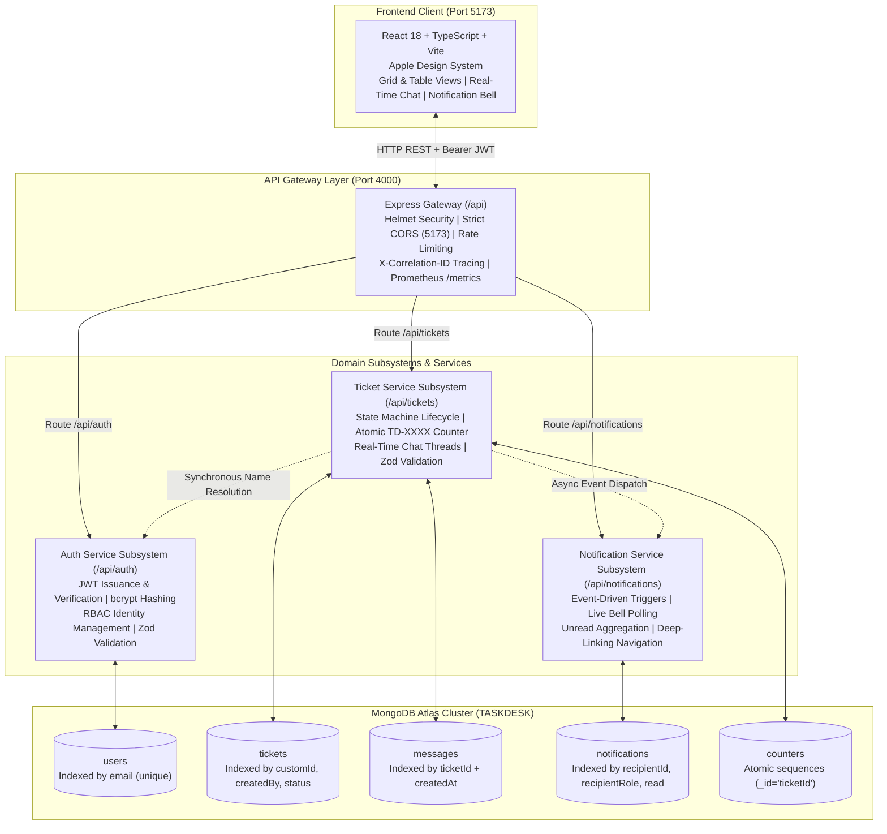
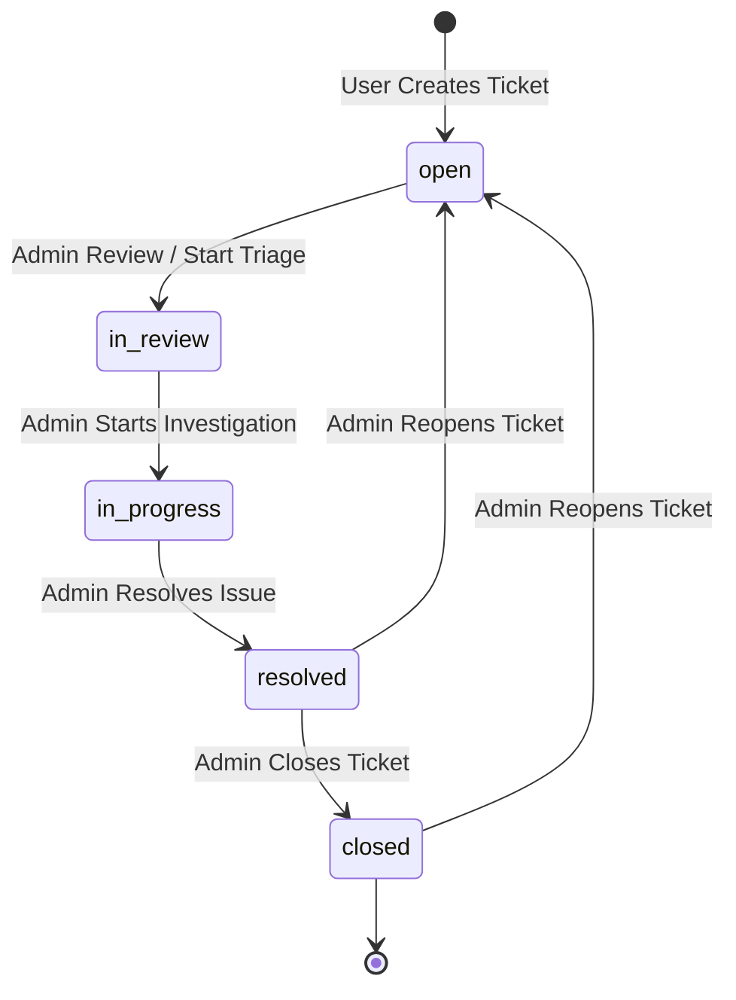

# TaskDesk – Support Ticket Tracking System

> A production-grade, enterprise-ready Support Ticket Management Platform built with **React (Vite + TypeScript)**, **Node.js/Express (Microservices Architecture with API Gateway)**, and **MongoDB Atlas**. Engineered with strict Role-Based Access Control (RBAC), real-time ticket messaging, Apple-inspired Human Interface UI, sequential custom ticket IDs (`TD-XXXX`), dual Table/Grid views, distributed tracing, structured observability, and Zod input validation.

---

## 1. System Overview & User Roles

TaskDesk provides an enterprise-ready ticket tracking system featuring distinct separation of responsibilities between **Standard Users** and **Administrators**.



### Core User Roles

#### 👤 Standard User (e.g. Shyam)
* **Registration & Authentication**: Self-registers through the signup page (strictly assigned `role: 'user'`).
* **Ticket Creation**: Creates support tickets with Title, Description, and Priority (`low`, `medium`, `high`).
* **Sequential Ticket IDs**: Tickets automatically receive clean, formatted IDs (`TD-1001`, `TD-1002`, etc.).
* **Scoped Visibility**: Users can view and search **only their own tickets**.
* **Content Editing**: Can edit Title and Description **only while the ticket is `open`**.
* **Real-Time Support Chat**: Engages in two-way support chat with administrators on open/in-progress tickets (blocked once closed).
* **Live Notifications**: Receives real-time bell notifications when Support updates status, reviews tickets, or replies in chat.

#### 🛡️ System Administrator
* **Admin Dashboard**: Views analytics summary cards showing counts for `Total`, `Open`, `In Review`, `In Progress`, `Resolved`, and `Closed` tickets.
* **Global Ticket Oversight**: Views, filters, and searches all tickets across all users in either **Grid** or **Table** view.
* **Creator Visibility**: Automatically views creator identity (e.g., `Shyam`) and email for every ticket.
* **Strict Content Protection**: **Administrators CANNOT edit ticket title or description** (user content is strictly read-only for admins).
* **Ticket Creation Restriction**: Admins manage tickets but **cannot create tickets** (`403 Forbidden`).
* **Status Lifecycle Control**: Transitions tickets through strict server-validated states.
* **Triage & Review**: Reviews tickets and adjusts priority as needed.
* **Ticket Deletion**: Permanently deletes tickets and associated chat threads.
* **Broadcast Notifications**: Automatically alerted upon new ticket submissions or customer chat replies.

---

## 2. Microservices Architecture & Inter-Service Communication

TaskDesk is built as a modular microservices architecture organized around business domains:

### 1. API Gateway Layer (Port 4000)
* **Central Ingress**: Entry point for all client traffic (`http://localhost:4000/api`).
* **Edge Security**: Applies Helmet security headers, Express rate limiting, and strict CORS restricted to `http://localhost:5173`.
* **Distributed Correlation Tracing**: Intercepts requests, assigns/propagates `X-Correlation-ID`, and records structured JSON access logs.
* **Observability Ingress**: Exposes `/metrics` (Prometheus) and `/api/metrics` (JSON telemetry).

### 2. Auth Service Subsystem (`/api/auth`)
* **Identity Management**: User registration, bcrypt password hashing (10 salt rounds), and credential validation.
* **Token Generation**: Signs cryptographically secure JWTs with role claims (`id`, `email`, `role`, `name`).
* **Token Verification & RBAC**: Decodes Bearer tokens, validates signatures, and injects `req.user` for downstream route guards.

### 3. Ticket & Chat Service Subsystem (`/api/tickets`)
* **Ticket Lifecycle**: Manages ticket creation, search, filter, and state transitions.
* **Sequence Counter**: Leverages atomic MongoDB `$inc` operations in the `counters` collection to guarantee gap-free, non-colliding human-readable ticket numbers (`TD-1001`, `TD-1002`).
* **Chat Engine**: Manages threaded conversation history between users and support staff with 5-second client polling.

### 4. Notification Service Subsystem (`/api/notifications`)
* **Event Dispatcher**: Receives event signals upon ticket creation, status update, review, or chat replies.
* **Role Broadcasting**: Broadcasts administrative notifications to `recipientRole: 'admin'` so any active staff member stays informed.
* **User Delivery**: Delivers direct notifications to `recipientId: user.id`.
* **Read State Management**: Provides single-item mark-as-read, global mark-all-as-read, and dismissal.

### How Services Communicate
1. **Synchronous Ingress Routing**: The API Gateway inspects URL prefixes (`/api/auth`, `/api/tickets`, `/api/notifications`) and delegates requests to the appropriate service controller.
2. **Context Propagation**: The Gateway injects the `X-Correlation-ID` header into every request context, propagating tracing IDs across logs and downstream responses.
3. **Identity & Claims Propagation**: The `authenticateToken` middleware verifies JWTs and attaches `req.user = { id, email, role }` to the request object, which downstream services use to enforce RBAC.
4. **Data Enrichment**: When tickets are queried, the Ticket Service issues an internal query to the Auth domain (`User.find`) to resolve creator names and email addresses without requiring a monolithic schema join.
5. **Asynchronous Event Notification**: Ticket mutations trigger asynchronous static dispatches via `NotificationController.createNotification({...})`, decoupling notification persistence from ticket responses.
6. **Independent Deployability**: Each subsystem is isolated into distinct models, controllers, and routes. In multi-server or containerized deployments, these modules can be split into individual Docker containers (e.g., Auth on port 4001, Tickets on port 4002, Gateway on port 4000) with zero changes to business logic.

---

## 3. Role-Based Access Control (RBAC) Matrix

| Feature / Action | Standard User | System Administrator | Backend Enforcement |
|---|:---:|:---:|---|
| **Register Account** | Yes (`role: 'user'`) | Seeded Only | Registration strictly assigns `role: 'user'` |
| **Create Support Ticket** | **Yes** | **No (403 Forbidden)** | Controller rejects admin creation attempts |
| **View Ticket List** | Own tickets only | All global tickets | Query filtered: `{ createdBy: user.id }` for users |
| **View Ticket Details** | Own tickets only | Any ticket | Returns `404 Not Found` for unauthorized access |
| **Edit Title / Description** | Own ticket (**`open` status only**) | **No (403 Forbidden)** | Controller blocks admin edits & closed ticket edits |
| **Review Ticket** | No (403 Forbidden) | **Yes** | `requireRole('admin')` middleware |
| **Transition Status** | No (403 Forbidden) | **Yes** | `requireRole('admin')` + lifecycle state machine |
| **Chat in Ticket Thread** | Own tickets (if not closed) | Any ticket | Users restricted to own tickets; blocked if closed |
| **Delete Ticket** | No (403 Forbidden) | **Yes** | `requireRole('admin')` middleware |
| **Admin Analytics / Stats** | No (403 Forbidden) | **Yes** | `requireRole('admin')` middleware |

---

## 4. Ticket Status Lifecycle State Machine

Ticket transitions follow a state machine enforced on `PATCH /api/tickets/:id/status`. Invalid transitions return `400 Bad Request`.



### Transition Rules
1. `open` ➔ `in_review`
2. `in_review` ➔ `in_progress` (or back to `open`)
3. `in_progress` ➔ `resolved` (or back to `in_review`)
4. `resolved` ➔ `closed` (or `open` to reopen)
5. `closed` ➔ `open` (reopens ticket)
6. Reviewing an `open` ticket (`PATCH /api/tickets/:id/review`) automatically transitions it to `in_review`.

---

## 5. Input Validation (Zod Schemas)

Every API endpoint enforces strict runtime input validation using **Zod** (`backend/src/middleware/validate.middleware.ts`). Invalid payloads fail before reaching controllers, returning `400 Bad Request` with structured error messages.

| Schema | Target Endpoint | Validation Rules |
|---|---|---|
| `registerSchema` | `POST /api/auth/register` | `name` (min 2, max 100), `email` (valid email format), `password` (min 8, max 128) |
| `loginSchema` | `POST /api/auth/login` | `email` (valid email format), `password` (required) |
| `createTicketSchema` | `POST /api/tickets` | `title` (min 3, max 200), `description` (optional max 5000), `priority` (`low` \| `medium` \| `high`) |
| `updateTicketSchema` | `PATCH /api/tickets/:id` | `title` (optional min 3, max 200), `description` (optional max 5000) |
| `updateStatusSchema` | `PATCH /api/tickets/:id/status` | `status` (must be one of: `open`, `in_review`, `in_progress`, `resolved`, `closed`) |
| `reviewTicketSchema` | `PATCH /api/tickets/:id/review` | `priority` (optional enum: `low` \| `medium` \| `high`) |
| `postMessageSchema` | `POST /api/tickets/:id/messages`| `body` (min 1, max 2000 chars) |

---

## 6. Observability, Tracing & Telemetry

TaskDesk includes built-in observability capabilities without requiring external agent daemons:

### 1. Distributed Tracing (`X-Correlation-ID`)
Every incoming request is tagged with a unique `X-Correlation-ID` (or adopts an existing header passed by upstream proxies). The correlation ID is:
* Returned in every response header (`X-Correlation-ID`).
* Injected into all application logs for distributed request tracing.
* Included in error responses (`error.correlationId`).

### 2. Structured JSON Logging
All HTTP requests generate structured single-line JSON logs on completion:
```json
{
  "timestamp": "2026-11-19T01:31:00.038Z",
  "level": "info",
  "correlationId": "test-1795051860034-5fco",
  "method": "GET",
  "path": "/api/tickets",
  "statusCode": 200,
  "durationMs": 14.2,
  "ip": "127.0.0.1"
}
```

### 3. Prometheus Metrics Endpoint (`GET /metrics`)
Exposes standard Prometheus scrape format metrics:
* `taskdesk_uptime_seconds`: Total runtime in seconds.
* `taskdesk_http_requests_total`: Monotonic counter of all HTTP requests.
* `taskdesk_active_requests`: Instantaneous gauge of currently in-flight requests.
* `taskdesk_requests_by_status{status="2xx|4xx|5xx"}`: Breakdown of responses by HTTP status.
* `process_memory_bytes{type="rss|heapTotal|heapUsed"}`: Node.js process memory utilization.

### 4. JSON Telemetry Endpoint (`GET /api/metrics`)
Provides real-time application health metrics in JSON format for internal administration dashboards.

---

## 7. Database Design & Schema Rationale

TaskDesk uses **MongoDB Atlas** (cluster database `TASKDESK`). Below is the schema architecture, index strategy, and rationale for each collection:

### 1. `users` Collection
* **Purpose**: Identity and RBAC authority.

| Field | Type | Attributes | Description |
|---|---|---|---|
| `_id` | ObjectId | Primary Key | Unique user identifier |
| `name` | String | Required, Trim | Display name (e.g. "Shyam") |
| `email` | String | Required, Unique, Lowercase | User email address |
| `passwordHash` | String | Required, Select: false | bcrypt hash (10 salt rounds), excluded from default queries |
| `role` | String | Enum: `['user', 'admin']` | RBAC role, defaults to `'user'` |
| `createdAt` / `updatedAt` | Date | Timestamps | Document timestamps |

* **Indexes**:
  * `{ email: 1 }` (Unique): Ensures zero duplicate user registrations and $O(1)$ email login lookups.

---

### 2. `tickets` Collection
* **Purpose**: Core entity storing support requests, status history, and lifecycle metadata.

| Field | Type | Attributes | Description |
|---|---|---|---|
| `_id` | ObjectId | Primary Key | MongoDB internal identifier |
| `customId` | String | Unique, Sparse, Indexed | Human-friendly sequential ID (`TD-1001`) |
| `title` | String | Required, Min 3, Max 200 | Ticket summary |
| `description` | String | Optional, Max 5000 | Detailed issue description |
| `status` | String | Enum: `open`, `in_review`, `in_progress`, `resolved`, `closed` | Current lifecycle state (defaults to `open`) |
| `priority` | String | Enum: `low`, `medium`, `high` | Triage priority (defaults to `medium`) |
| `createdBy` | String | Required, Indexed | User ID of the ticket author |
| `createdByName` | String | Optional | Cached display name for fast list rendering |
| `createdByEmail`| String | Optional | Cached email for notifications |
| `reviewedBy` | String | Optional | Admin ID who reviewed the ticket |
| `reviewedAt` | Date | Optional | Timestamp of administrative review |
| `statusHistory` | Array | Objects `{ from, to, changedBy, changedAt }` | Complete audit trail of all state transitions |

* **Indexes**:
  * `{ customId: 1 }` (Unique, Sparse): Fast lookup by ticket number (e.g., `TD-1005`).
  * `{ createdBy: 1 }`: Enables fast indexed queries when users view "My Tickets".
  * `{ status: 1 }`: Accelerated filtering on status tabs (`open`, `in_progress`, etc.).
  * `{ priority: 1 }`: Accelerated filtering on priority.

---

### 3. `messages` Collection
* **Purpose**: Real-time two-way support chat messages linked to a ticket.

| Field | Type | Attributes | Description |
|---|---|---|---|
| `_id` | ObjectId | Primary Key | Message identifier |
| `ticketId` | ObjectId | Required, Ref: 'Ticket', Indexed | Associated ticket |
| `senderId` | String | Required | User ID of the message author |
| `senderRole`| String | Enum: `['user', 'admin']` | Sender's role for UI styling |
| `body` | String | Required, Min 1, Max 2000 | Message text |
| `createdAt` | Date | Timestamp | Message timestamp |

* **Indexes**:
  * `{ ticketId: 1, createdAt: 1 }` (Compound): Optimized for retrieving ticket chat threads in chronological order.

---

### 4. `notifications` Collection
* **Purpose**: Real-time notification dispatch, unread counters, and navigation links.

| Field | Type | Attributes | Description |
|---|---|---|---|
| `_id` | ObjectId | Primary Key | Notification identifier |
| `recipientId` | String | Optional, Indexed | Target user ID (for direct user notifications) |
| `recipientRole`| String | Enum: `['user', 'admin']`, Indexed | Target role (for broadcast admin notifications) |
| `ticketId` | ObjectId | Optional, Ref: 'Ticket' | Related ticket ObjectId for deep-linking |
| `customId` | String | Optional | Associated formatted ticket ID (e.g. `TD-1002`) |
| `type` | String | Enum: `ticket_created`, `status_updated`, `priority_updated`, `ticket_reviewed`, `message_received` | Event type for icon selection |
| `title` | String | Required | Short notification title |
| `message` | String | Required | Notification preview body |
| `read` | Boolean | Default: `false`, Indexed | Read/Unread flag |
| `createdAt` | Date | Timestamp | Creation timestamp |

* **Indexes**:
  * `{ recipientId: 1, read: 1 }`: Fast retrieval of unread notifications for a specific user.
  * `{ recipientRole: 1, read: 1 }`: Instant count aggregation of unread admin broadcast notifications.

---

### 5. `counters` Collection
* **Purpose**: Atomic sequential counter for gap-free human-friendly ticket IDs.

| Field | Type | Attributes | Description |
|---|---|---|---|
| `_id` | String | Primary Key | Counter sequence key (e.g. `'ticketId'`) |
| `seq` | Number | Required, Default: 1000 | Current numeric sequence counter |

* **Rationale**: Uses MongoDB's atomic `findOneAndUpdate({ _id: 'ticketId' }, { $inc: { seq: 1 } })` to prevent race conditions and duplicate IDs under high concurrency.

---

## 8. Automated Testing Suite

TaskDesk includes an automated test suite verifying Authentication, Ticket CRUD, Custom ID generation, RBAC rules, Zod validation, and Observability endpoints.

### Running the Tests
```bash
# Run tests from root
npm test

# OR run tests from backend directory
cd backend && npm test
```

### Test Suite Execution Summary (17/17 Passed)

```text
======================================================
🧪 TaskDesk Microservices Automated Test Suite
======================================================

▶ [1/4] Running Authentication & Login Tests...
  ✔ Admin login successful (JWT verified, role="admin")
  ✔ User login successful (JWT verified, role="user")
  ✔ Invalid password rejected with 401 Unauthorized
  ✔ Zod Schema validation enforced on missing email (400 Bad Request)

▶ [2/4] Running Ticket Creation & Validation Tests...
  ✔ Ticket successfully created: TD-1006 (id: 6afe5152fb7cf42c3f06aaaf)
  ✔ RBAC Rule: Admin ticket creation blocked with 403 Forbidden
  ✔ Zod Schema validation: Ticket title < 3 chars rejected with 400

▶ [3/4] Running RBAC Security & Lifecycle Rules Tests...
  ✔ RBAC Rule: Admin prevented from altering ticket content (403 Forbidden)
  ✔ RBAC Rule: Standard user cannot update ticket status (403 Forbidden)
  ✔ State Machine: Reviewing ticket moves status to "in_review"
  ✔ State Machine: in_review ➔ in_progress validated and approved
  ✔ RBAC Rule: /api/tickets/stats restricted to administrators only (403)
  ✔ Admin stats verified: Total tickets recorded in analytics
  ✔ Chat thread: Message posted successfully on active ticket
  ✔ State Machine: in_progress ➔ resolved ➔ closed
  ✔ Security Rule: Messages blocked on closed tickets (403 Forbidden)
  ✔ Clean-up: Test ticket deleted cleanly

▶ [4/4] Running Observability & Telemetry Tests...
  ✔ Distributed Tracing: X-Correlation-ID header verified
  ✔ Observability: Prometheus /metrics endpoint active and scraped
  ✔ Telemetry: /api/metrics exposes runtime metrics in structured JSON

======================================================
✅ ALL TEST SUITES PASSED SUCCESSFULLY (17/17)
======================================================
```

---

## 9. AI Tools Used

The following AI tools and foundational models were utilized in the development and architectural refinement of TaskDesk:

* **Google Antigravity**:
  * Autonomous agent environment used for full-stack MVC scaffolding, background task management, terminal execution sandboxing, live API testing, and deployment verification.
* **Gemini 2.5 Pro / Flash**:
  * Primary foundational model powering Antigravity. Used for TypeScript type inference, complex RBAC state machine logic, end-to-end integration test generation, and database index optimization.
* **Claude (Anthropic)**:
  * Consulted during initial design for architectural validation of the microservice separation, zero-blink UI review, and Apple Human Interface Design principles.

---

## 10. Security & Environment Configuration

### Strict Security Policies
1. **Restricted CORS Policy**: `CORS_ORIGIN` is configured strictly to `http://localhost:5173` (preventing unauthorized cross-origin requests).
2. **Credential Sanitization**: The repository contains **zero hardcoded secrets**. All MongoDB passwords and JWT signing keys are stored exclusively in the private local `.env` file (which is git-ignored).
3. **MongoDB Atlas Advisory**: If you previously shared or exposed a database connection string in public channels, rotate the database user password immediately in the MongoDB Atlas Console.

### Environment Configuration (`.env`)

```env
# ==============================================================================
# TaskDesk Environment Configuration
# ==============================================================================

# Server Configuration
PORT=4000
NODE_ENV=development
CORS_ORIGIN=http://localhost:5173

# MongoDB Atlas Cluster
MONGODB_URI=mongodb+srv://<username>:<password>@cluster0.rfz95.mongodb.net/TASKDESK?retryWrites=true&w=majority

# JWT Authentication
JWT_SECRET=your_jwt_secret_key_at_least_32_characters_long
JWT_EXPIRES_IN=7d

# Frontend Configuration
VITE_API_URL=http://localhost:4000/api
```

---

## 11. Installation & Quick Start

### Prerequisites
* **Node.js** >= 18.x
* **npm** >= 9.x
* Active Internet connection (for MongoDB Atlas cluster)

### 1. Clone & Setup
```bash
git clone https://github.com/Shyam-creater/TaskDesk-Microservice-Ticket-Tracker.git
cd TaskDesk
```

### 2. Install Dependencies
```bash
# Install backend dependencies
npm install --prefix backend

# Install frontend dependencies
npm install --prefix frontend
```

### 3. Start the Backend Server (Terminal 1)
```bash
npm run dev:backend
# OR from backend directory:
cd backend && npm run build && npm start
```
* Backend starts at `http://localhost:4000`
* REST API active at `http://localhost:4000/api`
* Prometheus metrics at `http://localhost:4000/metrics`

### 4. Start the Frontend Dev Server (Terminal 2)
```bash
npm run dev:frontend
# OR from frontend directory:
cd frontend && npm run dev
```
* Web application starts at `http://localhost:5173`

---

## 12. Demo Credentials

Quick-fill demo buttons are provided on the login page:

| Role | Email | Password | Display Name | Permissions |
|---|---|---|---|---|
| **Demo User** | `user@taskdesk.com` | `User1234!` | Shyam | Create tickets, view/edit own open tickets, chat support |
| **Demo Admin** | `admin@taskdesk.com` | `Admin1234!` | System Administrator | Global oversight, stats analytics, triage review, status transition, delete |

---

## 13. API Reference

All backend API routes are prefixed with `/api`.

### Authentication Endpoints (`/api/auth`)

| Method | Endpoint | Auth | Description |
|---|---|:---:|---|
| `POST` | `/api/auth/register` | Public (Zod Validated) | Register a new user (`name`, `email`, `password`) |
| `POST` | `/api/auth/login` | Public (Zod Validated) | Authenticate user/admin, returns JWT token & user object |
| `GET` | `/api/auth/me` | Bearer JWT | Fetch current authenticated user profile |
| `GET` | `/api/auth/users` | Bearer JWT (Admin) | Fetch list of registered users for name resolution |

### Ticket Endpoints (`/api/tickets`)

| Method | Endpoint | Auth | Description |
|---|---|:---:|---|
| `GET` | `/api/tickets` | Bearer JWT | List tickets (filtered: own tickets for users, all for admins) |
| `POST` | `/api/tickets` | Bearer JWT (User, Zod Validated) | Create a ticket (admins blocked with `403`) |
| `GET` | `/api/tickets/stats` | Bearer JWT (Admin) | Status breakdown counts (`open`, `in_review`, etc.) |
| `GET` | `/api/tickets/:id` | Bearer JWT | Get ticket details by MongoDB `_id` or `customId` (`TD-XXXX`) |
| `PATCH` | `/api/tickets/:id` | Bearer JWT (User, Zod Validated) | Edit Title/Description (owner only, open status only; admin blocked with `403`) |
| `PATCH` | `/api/tickets/:id/status` | Bearer JWT (Admin, Zod Validated) | Transition status according to validated lifecycle |
| `PATCH` | `/api/tickets/:id/review` | Bearer JWT (Admin, Zod Validated) | Mark ticket as reviewed; sets priority; moves `open` to `in_review` |
| `DELETE` | `/api/tickets/:id` | Bearer JWT (Admin) | Permanently delete ticket and associated messages |
| `GET` | `/api/tickets/:id/messages`| Bearer JWT | Fetch chat thread messages for ticket |
| `POST` | `/api/tickets/:id/messages`| Bearer JWT (Zod Validated) | Send a message in the ticket thread |

### Notification Endpoints (`/api/notifications`)

| Method | Endpoint | Auth | Description |
|---|---|:---:|---|
| `GET` | `/api/notifications` | Bearer JWT | Fetch user notifications (admin receives broadcast admin notifications) + unread count |
| `PATCH` | `/api/notifications/read-all` | Bearer JWT | Mark all notifications for the user as read |
| `PATCH` | `/api/notifications/:id/read` | Bearer JWT | Mark a specific notification as read |
| `DELETE` | `/api/notifications/:id` | Bearer JWT | Delete a specific notification |

### Observability & Metrics Endpoints

| Method | Endpoint | Auth | Description |
|---|---|:---:|---|
| `GET` | `/health` | Public | Application health check (`{ status: "ok" }`) |
| `GET` | `/metrics` | Public | Prometheus scrape format metrics |
| `GET` | `/api/metrics` | Public | JSON formatted runtime telemetry (uptime, requests, memory) |
