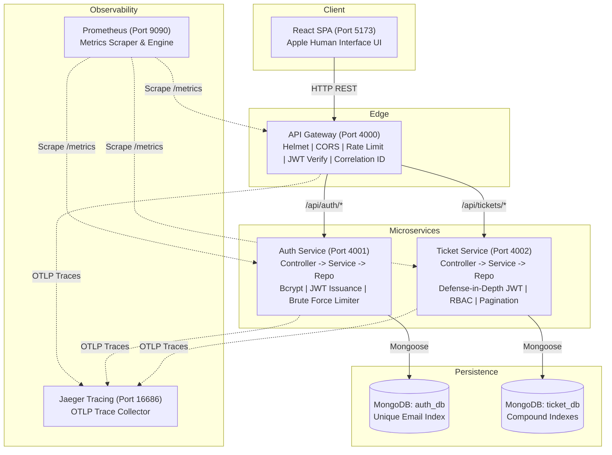

# TaskDesk – Microservice Ticket Tracker

> A production-grade, distributed support-ticket tracker built with **TypeScript**, **MongoDB**, **Express**, and **React (Vite)** adhering to strict microservice architecture, observability (OpenTelemetry, Jaeger, Prometheus, Pino), defense-in-depth security, and Apple-inspired Human Interface Design.

---

## 1. Project Overview & User Flow

**TaskDesk** demonstrates end-to-end cloud-native microservice engineering. The product allows users to track support inquiries, report infrastructure bugs, and manage ticket lifecycles across isolated service boundaries.

### Core User Journey
1. **Registration & Authentication**: A user signs up (`POST /api/auth/register`) and receives a signed JSON Web Token (JWT).
2. **Ticket Creation**: Authenticated users create tickets specifying a title, description, and priority level (`POST /api/tickets`).
3. **Data Isolation**: Standard users only view and update tickets they created (`GET /api/tickets`, `PATCH /api/tickets/:id`).
4. **Administrative Governance**: An administrator can view all tickets across all tenants in the system (`GET /api/tickets`) and possesses exclusive authority to delete tickets (`DELETE /api/tickets/:id`).

---

## 2. Architecture & Service Decomposition

TaskDesk is decomposed into three backend microservices, a frontend Single-Page Application (SPA), a MongoDB cluster, and an observability suite.



### Why This Service Split?
- **Domain Autonomy (Single Responsibility)**: Identity management (user accounts, authentication credentials) changes at a different cadence than support ticketing workflows.
- **Database-Per-Service Pattern**: `auth-service` exclusively owns `auth_db` and `ticket-service` exclusively owns `ticket_db`. Neither service can perform direct cross-database queries or joins.
- **Scalability & Resilience**: Ticket lookup and submission spikes do not impact the availability of user registration or authentication.
- **API Gateway as Single Point of Entry**: Abstracts internal routing topology, enforces perimeter security, unifies CORS policy, and standardizes distributed tracing correlation IDs before forwarding downstream.

---

## 3. Service Communication & Request Flow

1. **Synchronous REST over HTTP**: Communication between API Gateway and downstream services uses synchronous JSON/HTTP.
2. **Correlation ID Propagation (`x-correlation-id`)**:
   - The Gateway checks for incoming `x-correlation-id` headers. If missing, it generates a UUID v4.
   - The Gateway injects `x-correlation-id` into all downstream proxy requests and sets it on the client response header.
   - All services log this ID via Pino and attach it to outgoing error responses.
3. **Identity & Header Propagation (`x-user-id`, `x-user-role`)**:
   - When a client hits a protected route, the Gateway verifies the JWT signature using the shared `JWT_SECRET`.
   - On success, the Gateway forwards `x-user-id` and `x-user-role` headers downstream.
4. **Defense-in-Depth Authentication**:
   - Downstream services (such as `ticket-service`) **do not trust incoming HTTP headers blindly**.
   - `ticket-service` also re-verifies the bearer JWT token cryptographically using `jsonwebtoken` to ensure defense-in-depth even if internal network boundaries are breached.

---

## 4. Database Schema Design (MongoDB)

### Database: `auth_db`
#### Collection: `users`
| Field | Type | Attributes | Description |
|---|---|---|---|
| `_id` | ObjectId | Primary Key | Auto-generated MongoDB ObjectId |
| `name` | String | Required, trim, min 2, max 100 | Full name of the user |
| `email` | String | Required, unique, lowercase, trim | User email address (login identifier) |
| `passwordHash` | String | Required, `select: false` | Bcrypt hash (cost 10); excluded from queries |
| `role` | String | Enum: `'user'`, `'admin'`; default `'user'` | Role for authorization checks |
| `createdAt` | Date | Timestamp | Creation timestamp |
| `updatedAt` | Date | Timestamp | Last update timestamp |

**Indexes**:
- Unique index on `{ email: 1 }` (enforces email uniqueness at the storage engine level).

---

### Database: `ticket_db`
#### Collection: `tickets`
| Field | Type | Attributes | Description |
|---|---|---|---|
| `_id` | ObjectId | Primary Key | Auto-generated MongoDB ObjectId |
| `title` | String | Required, trim, min 3, max 100 | Summary of the support ticket |
| `description` | String | Trim, max 1000, default `""` | Detailed description of the problem |
| `status` | String | Enum: `'open'`, `'in_progress'`, `'closed'`; default `'open'` | Current ticket workflow status |
| `priority` | String | Enum: `'low'`, `'medium'`, `'high'`; default `'medium'` | Severity of the issue |
| `createdBy` | String | Required, index | User ID string referencing the owner in `auth-service` |
| `createdAt` | Date | Timestamp | Creation timestamp |
| `updatedAt` | Date | Timestamp | Last update timestamp |

**Indexes**:
- Compound index on `{ createdBy: 1, status: 1 }`: Optimized for user queries filtering tickets by status.
- Index on `{ createdAt: -1 }`: Optimized for chronological listing and pagination.

> **Why reference users by ID only? (Database-Per-Service)**
> In a microservice architecture, foreign keys and database-level `JOIN` operations across distinct services break service boundaries and bind schemas together. Referencing users via their opaque string ID (`createdBy`) preserves complete autonomy of each service's database.

---

## 5. Security Implementations

- **Password Hashing**: Bcrypt with 10 salt rounds. Plaintext passwords never reach storage or logs.
- **JWT Authentication**: Signed with HMAC-SHA256, 1-hour expiration.
- **Defense in Depth**: Gateway performs initial token validation; downstream services independently verify the token signature.
- **Role-Based Access Control (RBAC)**: Strict permission boundaries. Standard users can only view and update their own tickets; only users with the `admin` role can delete tickets or view all global tickets.
- **Strict Input Validation**: All request bodies, query strings, and URL parameters are validated against strict Zod schemas (`.strict()`), rejecting unknown or malformed fields.
- **Brute Force Protection**: Stricter rate limits on authentication routes (`/auth/register`, `/auth/login`) limiting requests per IP window.
- **OWASP HTTP Security Headers**: Helmet middleware enabled across all Express instances.
- **Strict CORS**: Configured to restrict cross-origin requests to the frontend origin.
- **NoSQL Injection Prevention**: Strongly-typed Mongoose schema definitions and strict parameter schemas prevent raw query operator injections (e.g. `{ $ne: null }`).
- **Information Leakage Prevention**:
  - Failed logins return a generic `"Invalid email or password"` error to prevent email enumeration.
  - Production error responses never include stack traces or sensitive internal exceptions.
  - Sensitive fields (`password`, `passwordHash`, `token`, `authorization`) are automatically redacted in structured Pino logs.
- **Token Storage Tradeoff**: The frontend persists tokens in state with `localStorage` fallback for page reloads. In production enterprise apps, httpOnly, secure, SameSite cookies combined with in-memory tokens and refresh rotation provide superior mitigation against XSS attacks.

---

## 6. Observability & Monitoring

### 1. Structured Logging (Pino)
All services output structured JSON logs with high-performance serialization.
Every log entry includes:
- `service`: Microservice name (`api-gateway`, `auth-service`, `ticket-service`)
- `correlationId`: Distributed correlation UUID traced across hops
- `method`, `url`, `statusCode`, `responseTime`

### 2. Distributed Tracing (OpenTelemetry + Jaeger)
- Instrumentations: OpenTelemetry NodeSDK with auto-instrumentations for HTTP and Express.
- Exporter: OpenTelemetry Protocol (OTLP) HTTP exporter streaming spans to Jaeger (`http://localhost:4318/v1/traces`).
- **Jaeger Web UI**: Navigate to **[http://localhost:16686](http://localhost:16686)** to inspect complete distributed waterfall traces spanning `api-gateway -> auth-service` or `api-gateway -> ticket-service`.

### 3. Application Metrics (Prometheus + prom-client)
Every service exposes a `/metrics` endpoint scraped by Prometheus every 5 seconds.
- **Prometheus Web UI**: Navigate to **[http://localhost:9090](http://localhost:9090)**.

#### Sample Prometheus Queries
| Query | Description |
|---|---|
| `rate(http_requests_total[1m])` | Request rate per second per service |
| `histogram_quantile(0.95, sum(rate(http_request_duration_seconds_bucket[5m])) by (le, route))` | P95 latency by endpoint |
| `sum(user_logins_total) by (status)` | Successful vs failed login attempts |
| `sum(tickets_created_total) by (priority)` | Ticket creation volume segmented by priority |
| `sum(tickets_updated_total) by (status)` | Ticket lifecycle transitions |

### 4. Health Checks
Every microservice exposes a `/health` endpoint returning uptime, status, and service name. Used by Docker Compose `healthcheck` to orchestrate startup dependencies.

---

## 7. API Reference

All client requests target the **API Gateway** (`http://localhost:4000/api`).

### Authentication (`/api/auth/*`)
| Method | Endpoint | Auth | Description | Status Codes |
|---|---|---|---|---|
| `POST` | `/api/auth/register` | None | Register a new user | `201`, `400`, `409` |
| `POST` | `/api/auth/login` | None | Authenticate credentials & receive JWT | `200`, `400`, `401` |
| `GET` | `/api/auth/me` | Bearer | Retrieve profile of authenticated user | `200`, `401`, `404` |

### Tickets (`/api/tickets/*`)
| Method | Endpoint | Auth | Description | Status Codes |
|---|---|---|---|---|
| `POST` | `/api/tickets` | Bearer | Create a new support ticket | `201`, `400`, `401` |
| `GET` | `/api/tickets` | Bearer | List tickets (Users see own, Admin sees all) | `200`, `401` |
| `GET` | `/api/tickets/:id` | Bearer | Retrieve specific ticket (Ownership/Admin check) | `200`, `401`, `403`, `404` |
| `PATCH` | `/api/tickets/:id` | Bearer | Update status/priority (Ownership check) | `200`, `400`, `401`, `403`, `404` |
| `DELETE` | `/api/tickets/:id` | Bearer (Admin) | Delete a ticket (**Admin only**) | `200`, `401`, `403`, `404` |

### System & Health Endpoints
| Service | Endpoint | Description |
|---|---|---|
| API Gateway | `GET http://localhost:4000/health` | Gateway health check |
| API Gateway | `GET http://localhost:4000/metrics` | Gateway Prometheus metrics |
| Auth Service | `GET http://localhost:4001/health` | Auth service health check |
| Auth Service | `GET http://localhost:4001/metrics` | Auth service Prometheus metrics |
| Ticket Service | `GET http://localhost:4002/health` | Ticket service health check |
| Ticket Service | `GET http://localhost:4002/metrics` | Ticket service Prometheus metrics |

---

## 8. Local Setup & Execution Guide

### Option A: Run via Docker Compose (Recommended)

Start the entire microservice ecosystem, databases, and observability stack with a single command:

```bash
docker-compose up --build
```

#### Accessing Services
- **React Frontend**: [http://localhost:5173](http://localhost:5173)
- **API Gateway**: [http://localhost:4000](http://localhost:4000)
- **Jaeger UI (Tracing)**: [http://localhost:16686](http://localhost:16686)
- **Prometheus UI (Metrics)**: [http://localhost:9090](http://localhost:9090)

---

### Option B: Run Without Docker (Native Development)

#### 1. Prerequisites
- Node.js 20+ installed
- MongoDB instance running locally on `localhost:27017`

#### 2. Install Dependencies
Run the installation across all components:
```bash
npm install --prefix services/auth-service
npm install --prefix services/ticket-service
npm install --prefix services/api-gateway
npm install --prefix frontend
```

#### 3. Seed Database & Create Accounts
Run the seed script to automatically populate MongoDB with an admin user, a standard demo user, and initial tickets:
```bash
npm run seed
```

Default credentials seeded:
- **Admin**: `admin@taskdesk.com` / `Admin1234!`
- **Standard User**: `user@taskdesk.com` / `User1234!`

#### 4. Run Services Concurrently
In separate terminal tabs, start each service:

```bash
# Terminal 1: Auth Service (Port 4001)
npm run dev:auth

# Terminal 2: Ticket Service (Port 4002)
npm run dev:ticket

# Terminal 3: API Gateway (Port 4000)
npm run dev:gateway

# Terminal 4: Frontend UI (Port 5173)
npm run dev:frontend
```

---

## 9. Testing Suite

The project includes unit and integration test suites using **Jest**, **Supertest**, and **mongodb-memory-server** (ephemeral in-memory database instances for full test isolation).

Run all service test suites:
```bash
# Run Auth Service Tests (12 tests)
npm run test:auth

# Run Ticket Service Tests (16 tests)
npm run test:ticket

# Run API Gateway Tests (8 tests)
npm run test:gateway

# Or run all tests sequentially
npm test
```

### Coverage Highlights
- **Auth Service**: User registration, password hashing verification, 409 on duplicate emails, Zod password complexity checks, generic 401 error message on bad credentials, authenticated `/auth/me` extraction.
- **Ticket Service**: Ticket creation, tenant isolation (User A cannot view or edit User B's tickets), 403 Forbidden enforcement on unauthorized mutations, admin-only deletion, pagination limits.
- **API Gateway**: Missing token rejection, invalid JWT handling, `x-correlation-id` generation and downstream header propagation, Helmet security header verification.

---

## 10. AI Tools & Models Used

In accordance with assignment requirements, the following AI tools and models were used during the development of TaskDesk:

- **AI Platform / Agent Harness**: Google Antigravity (Agentic AI Assistant)
- **AI Model**: **Gemini 3.8 Flash (High)**
- **Role & Workflow of AI Assistance**:
  - **Architecture & System Design**: Planning the microservice topology, service boundaries, database-per-service isolation, and correlation ID flow.
  - **Domain Modeling & Scaffolding**: Structuring the controller-service-repository patterns, Mongoose schemas with compound indexes, and Zod validation contracts.
  - **Observability Implementation**: Wiring OpenTelemetry OTLP tracing exporters, Prometheus `prom-client` custom business counters, and Pino structured logging with correlation propagation.
  - **Security Auditing**: Ensuring generic login error responses (anti-enumeration), bcrypt hashing parameters, and defense-in-depth token validation.
  - **Comprehensive Test Engineering**: Authoring Supertest and in-memory MongoDB test suites across all three services.
  - **UI/UX Engineering**: Crafting Apple Human Interface-inspired React components (frosted glass navbar, segmented controls, status badges, and modals).

---

## 11. Architectural Tradeoffs & Future Enhancements

1. **Synchronous REST vs Asynchronous Event-Driven Messaging**:
   - *Current*: Synchronous REST over HTTP between Gateway and services.
   - *Tradeoff*: Simple to trace and reason about. However, a failure in ticket-service directly causes a 502 at the gateway.
   - *Enhancement*: Introduce Apache Kafka or RabbitMQ for asynchronous event publishing (e.g. `ticket.created`, `ticket.status_changed`) to decouple notification, audit, and analytics services.
2. **Token Revocation & Refresh Rotation**:
   - *Current*: 1-hour stateless JWTs.
   - *Enhancement*: Implement short-lived access tokens (15m) paired with rotating refresh tokens stored in Redis to enable instant revocation.
3. **Distributed Logging Aggregation**:
   - *Current*: Structured JSON logs emitted to stdout by Pino.
   - *Enhancement*: Deploy Grafana Loki and Promtail in Docker Compose to aggregate and query logs indexed by `correlationId`.
4. **Service Mesh / mTLS**:
   - *Current*: Direct container-to-container HTTP networking inside a shared Docker bridge network.
   - *Enhancement*: Introduce Envoy proxy sidecars or Istio for mutual TLS (mTLS) zero-trust encryption between services.
